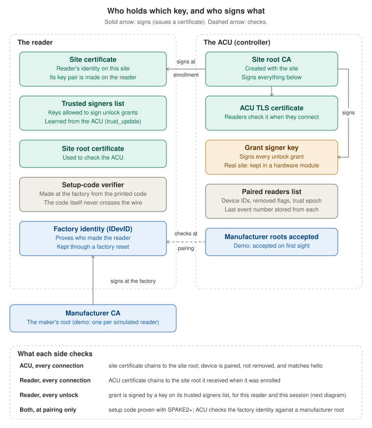
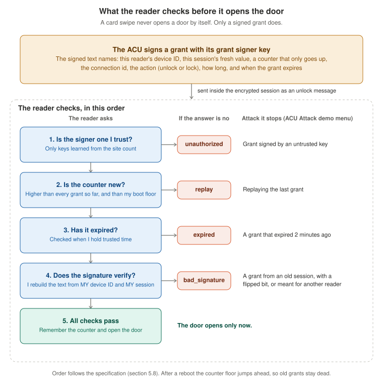
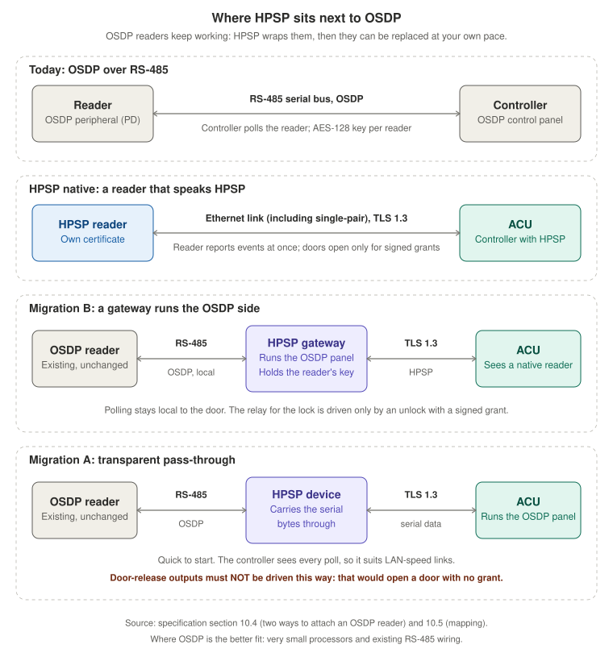
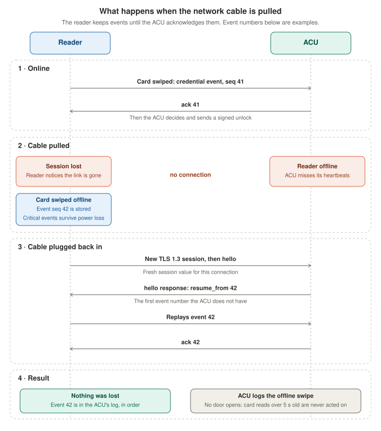

# HPSP in pictures

Four diagrams that explain the parts of HPSP people ask about most. For the end-to-end sequence (set up the ACU, pair the reader, connect, swipe a card, open the door), see the [flowchart in the README](../README.md#the-protocol-in-one-page).

## 1. Who holds which key, and who signs what

Two separate chains of trust meet at the reader. The **manufacturer** vouches for who made the reader, and that identity never changes. The **site root**, created with the site, vouches for everything that belongs to this installation: the ACU, the key that signs unlock grants, and the reader's site certificate, which the reader gets when it is enrolled. The factory identity is only used to start pairing. After that, everything runs on the site's certificates, which is why a reader can be factory-reset and paired to a different site.

## 2. What the reader checks before it opens the door

A card swipe tells the ACU who is at the door, but the ACU's decision reaches the door only as a signed **grant**. The reader runs the checks in the order shown, and the first failure stops the unlock. Each failure is a different attack in the ACU Simulator's **Attack demo** menu, so you can watch every gate work.

## 3. Where HPSP sits next to OSDP

HPSP is built to sit beside OSDP, not to replace it overnight. An existing OSDP reader can connect through a **gateway**, which runs the OSDP side at the door and presents a native reader to the ACU, or through **pass-through**, which carries the serial bytes to a controller that still runs OSDP. See section 10 of the specification for the details and the comparison.

## 4. What happens when the network cable is pulled

The reader numbers its events and keeps each one until the ACU acknowledges it. After a cable fault, the new session starts with a hello in which the ACU says which event number it wants next, and the reader replays everything from there. Nothing is lost and the order is preserved. A card read that is old by then is logged, but it never opens a door.

You can try this yourself: in the Reader Simulator, click **Pull network cable**, swipe a card, and plug the cable back in.
