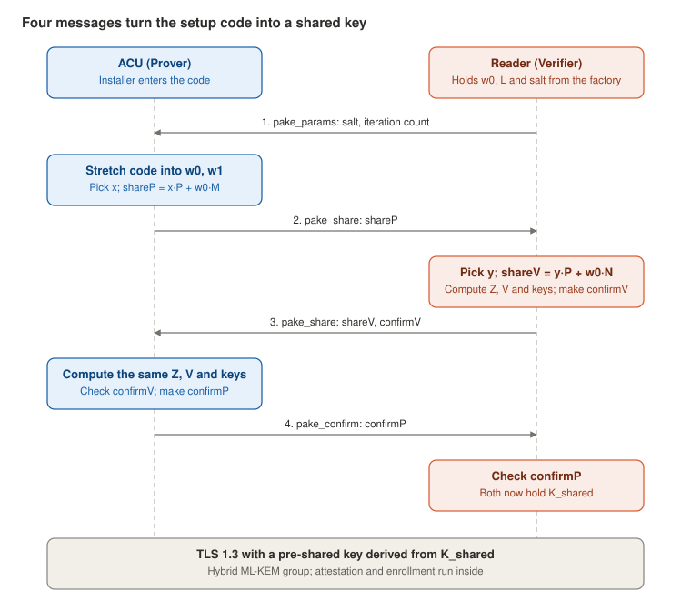

# SPAKE2+ explained: how HPSP pairs a reader with a setup code

SPAKE2+ lets the ACU and a reader prove they both know the reader's 8-character setup code and agree on a strong shared key. The code never crosses the network, and an eavesdropper gets nothing to guess against.

## The problem it solves

A new reader and the ACU have never met. The only secret they share is the 8-character setup code printed on the reader's label, which is about 40 random bits. HPSP needs to turn that short code into a strong, private link without exposing it.

The obvious approaches all fail:

- **Send the code, or a hash of it.** Anyone who records the traffic can test every possible code offline against the hash. 40 bits falls to a fast computer.
- **Use the code as a TLS pre-shared key.** This has the same problem: a recorded handshake lets an attacker check guesses offline, at full speed.
- **Rely on the reader's factory certificate alone.** The certificate proves the reader is genuine. It doesn't prove the reader is *this* one, the one the installer is standing in front of. A rogue reader with a valid certificate could be paired instead.

A **PAKE** (password-authenticated key exchange) fixes this. Each run lets an attacker test **one** guess, and only by taking part live. A recording reveals nothing that helps. HPSP then allows at most five live guesses per lockout period, so a 40-bit code is plenty.

SPAKE2+ is the *augmented* kind of PAKE: the reader never stores the code itself, only a value derived from it. Someone who extracts that value from a stolen reader still can't pose as the ACU without first recovering the code.

## How it works

If the installer typed the wrong code, the two sides compute different keys and the first confirmation check fails. The connection then closes with nothing learned. That counts as one of the five allowed attempts.

## The math in plain terms

SPAKE2+ works on the P-256 elliptic curve. P is the curve's standard generator. M and N are two fixed public points whose discrete logarithms nobody knows. Multiplying a point by a number is easy; undoing it is infeasible.

**1. From code to two numbers.** The setup code is stretched with a slow hash into two numbers, **w0** and **w1**.

**2. What each side keeps.** RFC 9383 calls the side that knows the password the **Prover** and the side that holds only a record the **Verifier**. In HPSP the ACU is the Prover and the reader is the Verifier.

| | Prover (ACU) | Verifier (reader) |
| --- | --- | --- |
| Holds | w0 and w1, computed from the code the installer enters | w0 and L = w1·P, written at the factory |
| Never has | Not applicable | The code, or w1 |

**3. Masked shares.** Each side picks a fresh random number and sends a share hidden behind w0:

$$\text{shareP} = X = x \cdot P + w_0 \cdot M \qquad \text{shareV} = Y = y \cdot P + w_0 \cdot N$$

Without w0, a share looks like a random point, so an eavesdropper can't remove the mask to test a guess.

**4. Two shared points.** Each side removes the other side's mask and computes the same two points, Z and V:

$$\text{ACU: } Z = h\,x\,(Y - w_0 N), \quad V = h\,w_1 (Y - w_0 N)$$

$$\text{Reader: } Z = h\,y\,(X - w_0 M), \quad V = h\,y\,L$$

h is the curve's cofactor, which is 1 for P-256.
- Z proves both sides used the same w0.
- V proves the ACU also knows w1. The reader can check this through L without ever holding w1. This second point is what makes the protocol augmented.

**5. Keys.** Both sides hash a transcript of everything exchanged into K_main: the context, both identities, M, N, both shares, Z, V and w0. From K_main they derive two confirmation keys and the shared key, K_shared.

**6. Confirmation.**
- The reader sends confirmV, a MAC over the ACU's share.
- The ACU sends confirmP, a MAC over the reader's share.

A wrong code gives different keys, so the MACs fail and both sides stop. Neither side treats the run as complete until it has checked the other side's confirmation.

## How HPSP uses it

HPSP fixes every choice that RFC 9383 leaves open, so any two implementations work together.

| Setting | HPSP value |
| --- | --- |
| Ciphersuite | P256-SHA256-HKDF-SHA256-HMAC-SHA256 (RFC 9383) |
| Stretching the code | PBKDF2-HMAC-SHA256 over the code (ASCII, upper case), with the reader's 16-byte salt and at least 100,000 iterations; 80 bytes out |
| w0, w1 | First and last 40 bytes, each read big-endian and reduced modulo the P-256 group order |
| Prover identity | `HPSP-controller` |
| Verifier identity | The reader's UUID, 16 bytes |
| Context | `HPSP-1 commissioning` |
| Transport | TCP port 7501, open only during the 10-minute pairing window |

**At the factory.** The setup code is printed on the label. Only w0, L, the salt and the iteration count are written into the reader. The code itself is never stored in the reader in readable form.

**The four messages.** Each message is a 4-byte length followed by CBOR, with `type` set to `pake`:

1. Reader → ACU, `pake_params`: protocol version, device ID, salt, iteration count. The ACU now stretches the code the installer entered.
2. ACU → reader, `pake_share`: shareP, an uncompressed P-256 point (65 bytes).
3. Reader → ACU, `pake_share`: shareV (65 bytes) and confirmV (32 bytes).
4. ACU → reader, `pake_confirm`: confirmP (32 bytes).

**Checks.** Each side must reject a share that isn't a valid P-256 point or is the identity point. Each side must also compare confirmation values in constant time. Any failure sends `pake_fail`, closes the connection and counts toward the five-attempt limit.

**Then TLS.** Both sides compute a 32-byte pre-shared key, HKDF-Expand(K_shared, "HPSP-1 commissioning psk", 32), and start TLS 1.3 on the same connection:
- key exchange mode `psk_dhe_ke`;
- cipher suite `TLS_AES_128_GCM_SHA256`;
- identity `hpsp-commissioning-1`;
- the reader is the TLS server.

Since version 0.6 this handshake uses the hybrid ML-KEM group. Attestation and enrollment then run inside it.

In the demo, the code is in `Hpsp.Core/BouncyCastle/Spake2Plus.cs`, and the activity window shows all four messages during pairing.

## What it protects, and what it doesn't

| Threat | Result |
| --- | --- |
| Someone records the pairing | They learn nothing that lets them test guesses offline. The code stays secret. |
| Someone joins live and guesses | One guess per run. After five failures the reader locks out for 5 minutes, and each further failure doubles the lockout, up to one hour. The count survives power cycles. |
| A stolen reader is taken apart | The attacker gets w0 and L, not the code. To pose as the ACU they must first recover the code from them by brute force, slowed by the 100,000-iteration PBKDF2. A reader already in service also ignores its pairing button. |
| A photo of the label leaks the code | Useless without someone pressing the reader's button, which only opens a 10-minute window. |
| A rogue ACU holds the code | SPAKE2+ alone can't stop this. That's why HPSP also requires the physical button press and checks the reader's factory certificate (attestation) inside the protected link. |

The button, the code and the attestation are each required; none of them is enough alone.

**Post-quantum note.** SPAKE2+ relies on elliptic-curve math that a large quantum computer could break, and there's no standardized post-quantum replacement yet. HPSP 0.6 keeps SPAKE2+ but runs the TLS that follows with the hybrid ML-KEM group. Attestation, enrollment and the new site certificate therefore stay private even if a future attacker breaks a recorded SPAKE2+ exchange. A code recovered that way is of little use, because the reader is already in service and ignores its pairing button.

**Standards status.** RFC 9383 was published in September 2023 as an Informational RFC on the Independent Submission stream, so it isn't an IETF Standards Track document.

Matter's smart-home pairing (PASE) is also built on SPAKE2+, with a 27-bit setup passcode. A 2025 analysis of Matter flagged low-entropy passcodes, fixed per-device salts and weak PBKDF2 settings as weaknesses. HPSP's code is longer (40 bits) and needs at least 100,000 iterations. Its salt is also fixed per device, though, which is worth reviewing.

## Why SPAKE2+ and not something else

SPAKE2+ was chosen because it is the only widely used option that both resists offline guessing *and* keeps a usable secret off the reader. It also runs in a short, fixed exchange that a microcontroller can handle.

| Option | Recording lets attacker test guesses offline? | Stolen reader gives a usable secret? | Fit for HPSP pairing |
| --- | --- | --- | --- |
| **SPAKE2+** (augmented PAKE, RFC 9383) | No | No: reader holds only w0 and L | Chosen: four messages, P-256 only, used by Matter |
| SPAKE2 (balanced PAKE, RFC 9382) | No | Yes: reader stores a code-equivalent secret | Weaker if a reader is stolen |
| CPace (balanced PAKE, CFRG) | No | Yes, as with SPAKE2 | Same drawback |
| OPAQUE (augmented PAKE, CFRG) | No | No | Built for password login to a server; more messages and an OPRF, heavier on a small reader |
| Code as a TLS pre-shared key | Yes | Yes | Unsafe with a 40-bit code |
| Factory certificate alone | Not applicable | Not applicable | Proves the reader is genuine, not that it's the one in front of the installer |

## Sources

- [RFC 9383: SPAKE2+, an Augmented Password-Authenticated Key Exchange (PAKE) Protocol](https://www.rfc-editor.org/rfc/rfc9383.html), September 2023. Message flow, formulas, key schedule and ciphersuites.
- [HPSP 0.6 implementation draft (PDF)](../spec/HPSP_v0.6_implementation_draft.pdf). Commissioning procedure, commissioning messages, limits, post-quantum commissioning.
- [Matter security overview (Nordic Semiconductor)](https://nrfconnectdocs.nordicsemi.com/addons/ncs-matter/latest/matter/overview/security.html). PASE and SPAKE2+ in Matter.
- [Matter commissioning (Nordic Semiconductor)](https://nrfconnectdocs.nordicsemi.com/addons/ncs-matter/latest/matter/overview/commissioning.html). The 27-bit setup passcode.
- [IACR ePrint 2025/1268](https://eprint.iacr.org/2025/1268). An analysis of Matter's PASE and CASE.

---

Part of the [HPSP concept demo](../README.md). Licensed under CC BY 4.0, like the specification.
